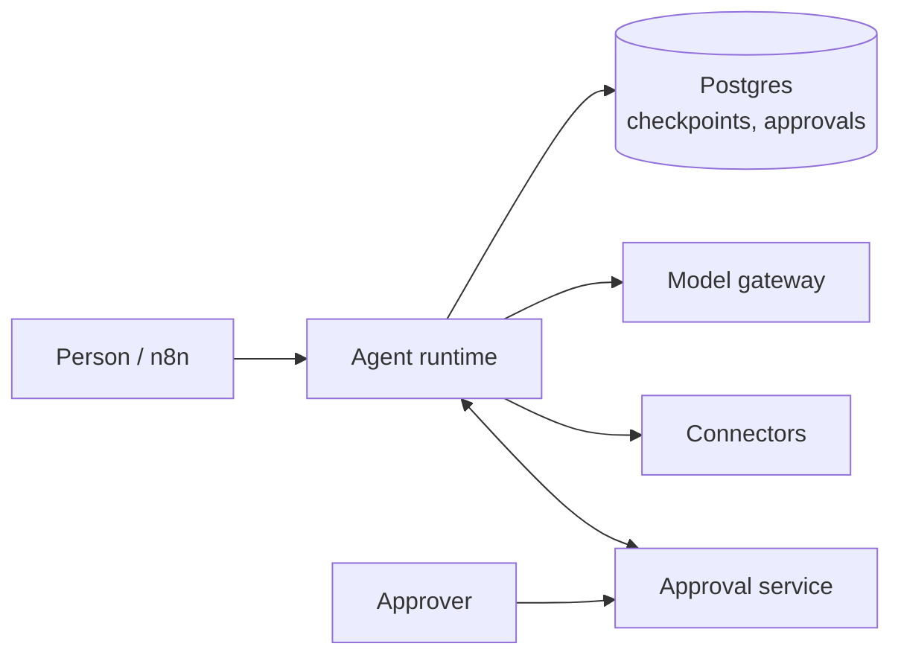

# aurai-agent-runtime

The agent layer of the Aurai platform: a runtime that runs agents with durable state, and an approval service that makes sure no consequential action happens until people have approved that exact action.

> **Synthetic project.** Aurai is a fictional enterprise AI platform for the fictional company "Amazing-Enterprise". All data here is invented, and the connectors the agent talks to are in-memory stand-ins. This is a working prototype with production patterns, not a production system; the gaps are listed below.

## What it does

- **A runtime with checkpoints.** Agents are LangGraph graphs. State is saved to Postgres after every step, so a run that is waiting for a person survives a restart and resumes on any replica.
- **Approval that cannot be skipped or reused.** An agent proposes an action; the connector says how many approvals it needs; people approve in the approval service; only then does the agent receive a signed, single-use token bound to that exact call. Nobody approves a request they, or their agent, made.
- **Agents with their own identity.** Each agent runs as its own Keycloak service client whose team and use case are fixed claims, so connector policy and audit see the real use case. The clients are created from `config/agents.yaml`.
- **The model returns data, not tool calls.** The reference agent, `ops-insights`, reads downtime, incidents and tickets and proposes up to three draft tickets. What it can propose is defined in code and re-checked by the connectors.
- **A template and two other ways in.** `aurai-agents new` scaffolds a governed agent that passes its own tests. An n8n workflow starts and resumes runs through the runtime API. A Claude Agent SDK reference shows the same controls where the model does choose tools.



## Requirements covered

From the Aurai PRD, Agents area.

| ID | Requirement | Where |
|---|---|---|
| AG-1 | Production agent runtime with state and checkpoints (P0) | `runtime.py`, `checkpoint.py`, [docs/state-and-checkpoints.md](docs/state-and-checkpoints.md) |
| AG-2 | Human approval gate for consequential actions (P0) | `kit.py`, `approval_*.py`, [docs/approvals.md](docs/approvals.md) |
| AG-3 | Low-code workflow option (P1) | `n8n/`, [docs/n8n.md](docs/n8n.md) |
| AG-4 | Templates for common agent patterns (P1) | `aurai-agents new`, [docs/agent-authoring.md](docs/agent-authoring.md) |
| AG-5 | Sandboxed tool execution (P2) | Not built |

Spans use the `aurai.agent.step` and `aurai.approval` conventions from `aurai-eval-governance`, and a test validates them against that library when it is installed.

## Try it without a cluster

```powershell
pip install -e ".[dev]"
ruff check .
pytest -q
$env:AURAI_APPROVAL_SIGNING_KEY = "local-only-signing-key-0123456789abcdef"
aurai-agents check
aurai-agents new my-agent --team ops-insights --use-case my-agent --tier T1 --directory $env:TEMP\scratch
```

Tests that need a Postgres, the real connector servers or the governance library skip themselves when those are missing; [docs/local-development.md](docs/local-development.md) says how to switch each on and how to deploy to the local kind cluster.

## Repository layout

| Path | Contents |
|---|---|
| `src/aurai_agents/` | `runtime.py` and `runtime_api.py`; `kit.py` (shared approval gate); `agents/`; `approval_service.py`, `approval_store.py`, `approval_api.py`, `approval_tokens.py`; `connector_client.py`, `approval_client.py`, `model.py`, `tokens.py`; `verify.py`; `keycloak_clients.py`; `scaffold.py` and `template/`; `testing.py`; `reference/`; `cli.py` |
| `config/` | `agents.yaml` (the agents), `approvers.yaml` (who may approve for each team) |
| `n8n/` | Example workflow |
| `charts/aurai-agents/` | Runtime and approval service Deployments and Services, config map, init Job, NetworkPolicy, values for local and AWS |
| `scripts/` | Local deploy, port-forward, undeploy |
| `docs/` | Architecture, approvals, state and checkpoints, identity, agent authoring, n8n, frameworks, local development, runbook |

## Honest status

**Verified here**
- 134 tests pass with a Postgres available (129 pass and 5 skip without), ruff clean. They cover: the approval service's decision rules (group membership, self-approval, one decision each, expiry, token limits, idempotency); the whole agent flow through pause, approval, rejection, expiry, a restart on the same checkpointer and a duplicate resume; hostile model output and prompt-injected data; both HTTP APIs, including wrong-audience and cross-owner access; the Keycloak plan and apply logic against a mock admin API; the scaffold, which generates an agent whose own tests pass; the n8n file's structure.
- Against a real Postgres: the LangGraph checkpointer resuming a waiting run after a simulated process restart, the approval store, and two simultaneous decisions by the same approver recording once.
- Against the real servers from aurai-mcp-connectors, with the real OPA policy: reads, the approval requirement, a token accepted once and only for those arguments, and a whole agent run ending in a created draft ticket. Tokens minted here are accepted by the connectors' verifier.
- The chart's template syntax parses.

**Not verified**
- `helm lint`, `helm template`, kubeconform and the container build were not run here; CI runs them. Nothing has been deployed to a cluster, and the deploy scripts have not been run.
- Nothing has run against a real Keycloak. Tokens in tests are signed with locally generated keys, and the client definitions were tested only against a mock admin API. The approver groups (`approvers-ops`, `approvers-finance`) and two demo approvers are defined in the aurai-workspace realm, but that realm has not been re-applied to a running Keycloak.
- No live model: the model client is tested against a mocked gateway and a scripted model. The Claude Agent SDK reference was tested without the SDK running a model.
- The n8n workflow was not imported into a running n8n.
- There is no approval interface, only the HTTP API.

**What production would add**
- An approval experience: a console or chat integration that shows approvers the exact call, notifications, reminders and escalation, and delegation rules.
- Asynchronous execution. `POST .../runs` currently runs the graph inside the request until it finishes or pauses; a queue and workers, callbacks instead of polling, per-agent concurrency limits and cancellation.
- Asymmetric approval signing with key rotation (today a shared HS256 key, with no overlap window), and token exchange so connectors see the person behind a run.
- Retention for checkpoints, a durable audit export of approval decisions, and an alert on runs that outlive the approval lifetime.
- Egress rules (the NetworkPolicy restricts ingress only), secrets from a manager, per-agent secret rotation and HA Postgres.
- Per-user and per-agent rate limits and cost guards on model calls, and evaluation of agent outputs in `aurai-eval-governance` gates.

## License

MIT. See [LICENSE](LICENSE).
