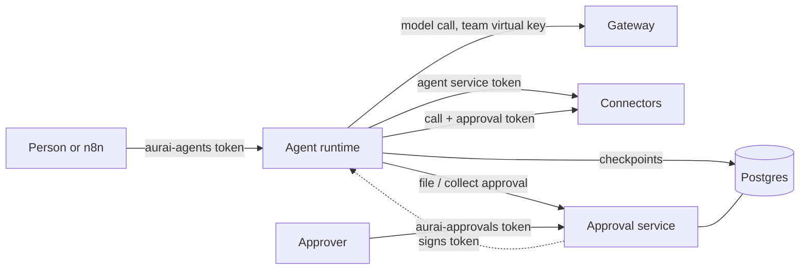

# Architecture

Two services, one database, and the platform services they already depend on.

## Components

| Component | What it does |
|---|---|
| **Agent runtime** (`runtime.py`, `runtime_api.py`) | Starts runs of registered agents, reports status, resumes them. One run is one LangGraph thread, `<agent>:<run id>`, owned by the person who started it. |
| **Agents** (`agents/`, `kit.py`) | LangGraph graphs. `kit.py` holds the shared `AgentContext` and `ApprovalGate`, so every agent gets the same approval behaviour. |
| **Approval service** (`approval_*.py`) | Holds approval requests, enforces who may decide, and signs the single-use token a connector accepts. |
| **Checkpointer** (`checkpoint.py`) | Postgres in the deployed system; memory for tests. See [state-and-checkpoints.md](state-and-checkpoints.md). |
| **Keycloak clients** (`keycloak_clients.py`) | The service clients agents run as, as code. See [identity.md](identity.md). |

## One run, end to end

1. A person (or n8n) calls `POST /v1/agents/ops-insights/runs`. The runtime verifies the token (audience `aurai-agents`), validates the input, and starts a LangGraph thread.
2. **gather**: the agent reads downtime, incidents and open tickets through the connectors, as its own service account. A connector that refuses a read is recorded and the run continues.
3. **draft**: the model, called through the gateway with the use case's key, returns a briefing and up to three proposed tickets as JSON. This is untrusted text: `parse_model_output` keeps only well-formed `tickets_create_draft` proposals for known areas.
4. **open_approvals**: for each proposal the gate calls the connector *without* a token. The connector answers `approval_required` with the exact number of approvals and the argument hash it will accept. The gate files an approval request with that requirement. The idempotency key is `<run id>:<index>`, so re-running the node never creates duplicates.
5. **wait**: while any request is pending the graph calls `interrupt()`. The checkpoint is already saved, so the process can stop; any replica can resume the run.
6. People decide in the approval service. Nobody can decide on a request they, or the agent acting for them, made.
7. `POST .../resume` re-enters the graph. **execute** collects a signed token for each approved request and calls the connector once. Rejected and expired requests are recorded and never run.
8. **summarize** ends the run. `GET .../runs/<id>` returns the briefing, the approval states and what happened to each action.

## Why the model does not choose tools

In the LangGraph agent the model returns data, never tool calls. The set of actions an agent can ever propose is fixed in the graph (`tickets_create_draft`, with a title, body and area). Text the model reads (ticket bodies, incident summaries) cannot widen that set. The connectors check the same limits again, and a write still needs a person's approval whatever the model says. [frameworks.md](frameworks.md) shows how the same control moves into the permission callback when an SDK does let the model pick tools.

## Requirements covered

| ID | Requirement | Where |
|---|---|---|
| AG-1 | Production agent runtime with state and checkpoints | `runtime.py`, `checkpoint.py`, `agents/ops_insights.py` |
| AG-2 | Human approval gate for consequential actions | `kit.py` (`ApprovalGate`), `approval_service.py`, [approvals.md](approvals.md) |
| AG-3 | Low-code workflow option | `n8n/`, [n8n.md](n8n.md) |
| AG-4 | Templates for common agent patterns | `aurai-agents new`, `template/`, [agent-authoring.md](agent-authoring.md) |
| AG-5 | Sandboxed tool execution | Not built. Tools run in the connectors, behind policy; there is no code-execution tool. |
