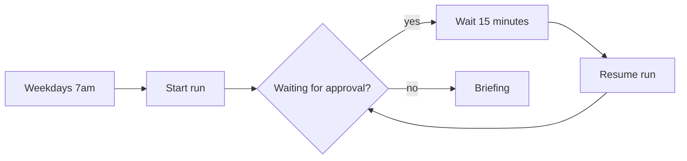

# n8n workflows (AG-3)

Business builders can orchestrate agents in n8n without writing Python. The rule that keeps this safe: **n8n starts and resumes runs through the runtime API, and does nothing else.** It never calls a connector and never touches approvals.

`n8n/ops-insights-weekday-briefing.json` is the example. Every weekday at 7:00 it starts an ops-insights run, then loops: while the run says `waiting_approval`, wait 15 minutes and resume it; when it completes, the `Briefing` node holds the briefing and what happened to each proposed action. Wire a notification or a post after that node.

## Why it is built this way

- **Least privilege.** The workflow's credential is the `n8n-orchestrator` Keycloak client. Its tokens carry the audience `aurai-agents` and nothing else, so connectors and the approval service refuse them. A compromised or edited workflow can start runs; it cannot read a ticket or approve an action.
- **Approvals stay with people.** The loop only waits. Approvers decide in the approval service. A 24-hour request lifetime ends the loop on its own: an undecided action expires and the run completes.
- **No secrets in the file.** The URL comes from the `AURAI_RUNTIME_URL` environment variable of the n8n instance, and the token from an OAuth2 client-credentials credential in n8n named `Aurai agents (client credentials)`.

## Setup

1. `aurai-agents keycloak-apply` creates `n8n-orchestrator` (see [identity.md](identity.md)).
2. In n8n, create an *OAuth2 API* credential: grant type *Client Credentials*, the realm's token URL, client id `n8n-orchestrator`, its secret. Name it as the workflow expects.
3. Set `AURAI_RUNTIME_URL` for n8n (for the local cluster, a port-forward to the runtime; see [local-development.md](local-development.md)).
4. Import the JSON. It ships inactive.

`tests/test_n8n_workflow.py` checks the file's structure and these properties: only the runtime is called, no secret appears, and the loop goes through the wait. It does not run n8n; importing into a real instance has not been verified.

## Limits

A run waiting for an approval ties up one workflow execution; at scale, use a webhook callback instead of polling. The runtime does not call back today.
